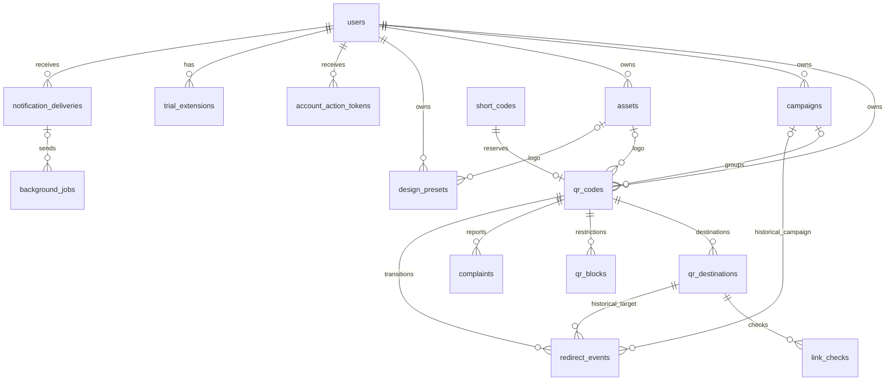

# Модель данных MVP

Основа PostgreSQL для всего MVP: аккаунты, динамические QR, библиотека дизайнов,
аналитика, модерация, уведомления и фоновые задания. Продуктовые правила находятся
в [продукте](product.md), границы компонентов — в [архитектуре](architecture.md).

Миграции создают структуру и ограничения. Обработчики сценариев, worker,
отправка почты, провайдеры проверки ссылок и аналитические запросы реализуются
следующими шагами. Созданная таблица не означает готовность соответствующей функции.

## Сущности и связи

| Таблица                   | Назначение                                                                                                  |
| ------------------------- | ----------------------------------------------------------------------------------------------------------- |
| `users`                   | Аккаунт и владелец ресурсов; роль, часовой пояс, подтверждение email, пробный доступ, блокировка и удаление |
| `sessions`                | Серверные сессии в формате AdonisJS                                                                         |
| `account_action_tokens`   | Хеши одноразовых токенов подтверждения email и восстановления доступа                                       |
| `trial_extensions`        | Кто, когда, по какой причине и до какой даты продлил пробный доступ                                         |
| `assets`                  | Файлы логотипов: ключ хранения, владелец и проверенные характеристики изображения                           |
| `campaigns`               | Кампании владельца, включая архивные                                                                        |
| `design_presets`          | Независимые именованные снимки оформления                                                                   |
| `short_codes`             | Постоянный реестр выданных коротких адресов без содержимого и владельца                                     |
| `qr_codes`                | Динамический QR, оформление, текущая кампания, ручная пауза и корзина                                       |
| `qr_destinations`         | Кандидаты назначения, решения об активации и история смен                                                   |
| `link_checks`             | Отдельные попытки проверки конкретного назначения                                                           |
| `qr_blocks`               | Независимые причины блокировки QR и история их снятия                                                       |
| `complaints`              | Жалобы, обращения о пересмотре и результат рассмотрения                                                     |
| `audit_logs`              | Административное действие, автор, причина и идентификатор цели                                              |
| `redirect_events`         | Исходные события успешных переходов с историческим контекстом                                               |
| `notification_deliveries` | Намерение отправить уведомление и результат доставки                                                        |
| `background_jobs`         | Транзакционная постановка работы, расписание, попытки и аренда worker                                       |

Полный состав полей, значений и ограничений хранится в
[миграциях](../apps/backend/database/migrations/). `database/schema.ts`
генерируется Lucid после применения миграций и не редактируется вручную.

Модели в `app/models` создаются через `node ace make:model <Name>` и наследуют
сгенерированные schema-классы. Связи объявляются в моделях декораторами
`belongsTo`, `hasMany`, `hasOne` и типами из `@adonisjs/lucid/types/relations`;
имена нестандартных ключей задаются в настройках декораторов. Эти связи обеспечивают
типизированные `related` и `preload`, а внешние ключи миграций проверяют целостность,
включая принадлежность ресурсов одному владельцу. Связи Lucid используют уникальный
идентификатор ресурса; составная проверка владельца остаётся на стороне PostgreSQL.
Необязательные связи имеют тип `BelongsTo<...> | null` или `HasOne<...> | null`.
Настройки генерации нестандартных колонок находятся в `database/schema_rules.ts`.
Предметные поля с фиксированным набором значений уточняются через `declare`
непосредственно в моделях; соответствующие строковые enum экспортируются из тех же
файлов. Декораторы колонок наследуются из schema-классов. Enum обеспечивает
проверку значений в TypeScript, а ограничения миграций — в PostgreSQL.

В миграциях простые ограничения задаются методами колонок (`checkIn`,
`checkPositive`, `checkRegex`, `checkBetween`), а правила между несколькими полями —
`table.check`. Индексы, включая частичные, объявляются через `table.index` и
`table.unique`; предикаты с фиксированными значениями используют SQL-литералы,
поскольку параметры не поддерживаются в PostgreSQL DDL индексов. Триггер постоянства
коротких кодов создаётся через `this.schema.raw`.

Новые предметные сущности используют UUID; существующие идентификаторы пользователей
сохранены. Потоки событий и аудита используют bigint. Даты новых полей имеют тип
`timestamptz`; границы пользовательских периодов вычисляет приложение по часовому поясу.

## Владение и данные аккаунта

Для ресурсов с владельцем составные внешние ключи проверяют принадлежность
кампании, логотипа, QR, назначения, события и уведомления одному аккаунту.
Это дополнение к проверкам авторизации в API: знание UUID не предоставляет доступ.

Роль по умолчанию пользовательская; право назначать администратора проверяет приложение.
Уникальность email учитывает регистр и пробелы по краям. Нормализация при записи
и поиске по email должна использовать ту же идентичность.

Токен действия хранится только как хеш, привязан к email на момент выдачи и имеет
срок, отметку использования или отзыва. Потребление требует атомарного обновления
по неиспользованному, неотозванному и непросроченному токену с проверкой текущего email.
Для отправки секретная ссылка помещается в зашифрованный payload уведомления.

Сессии сохраняют стандартный формат AdonisJS: `user_id` — строковая метка,
а не обычный внешний ключ к числовому `users.id`. Вход и регистрация устанавливают
эту метку через `session.tag`. При запросе удаления аккаунта и блокировке
обработчик отзывает все помеченные сессии; при окончательной очистке удаляет их
вместе с аккаунтом. Один внешний ключ эту работу не заменяет.

Окончательная очистка аккаунта выполняется транзакционно: сохранить ключи файлов
для последующей очистки диска, удалить помеченные сессии, QR со всеми зависимостями,
пресеты, затем пользователя с оставшимися файлами и кампаниями. Такой порядок
снимает перекрёстные ссылки до удаления родителей. Один `DELETE users` с неочищенными
QR/пресетами может быть отклонён защитными внешними ключами.

Начало и конец пробного доступа находятся у пользователя и не зависят от существования
его QR. История продлений хранится отдельно. При первом создании QR, продлении,
создании пресета и восстановлении QR обработчик блокирует строку пользователя
в транзакции, проверяет актуальные даты и лимиты, затем выполняет запись.
Миграции сами не обеспечивают ограничения количества, проверку email или планировщик сроков.

## Адреса, назначения и ограничения QR

Сначала в транзакции резервируются короткий код и UUID будущего QR, затем создаётся QR.
Составной ключ связывает код с этим UUID; другой QR не может занять прежний код.
Триггер запрещает обновление и удаление записи реестра. После окончательного удаления
QR остаются только код, его технический UUID и дата резервирования.

У модели `ShortCode` первичный ключ — `code`. Связь с существующим QR использует
`qr_codes.short_code`; технический `short_codes.qr_code_id` не объявляется внешним
ключом или `belongsTo`, поскольку его значение сохраняется после удаления QR.

Назначение создаётся кандидатом. Пока проверка не завершена, прежнее активное
назначение продолжает работать. Частичные уникальные индексы разрешают максимум
одного ожидающего кандидата и одно активное назначение на QR. При замене кандидата
предыдущий отменяется; при активации одобренного назначения прежнее закрывается
в той же транзакции. Результат повторной проверки создаёт отдельную запись;
обнаружение угрозы блокирует QR, не переписывая прошлое решение об активации.

Ручная пауза, корзина и причины блокировки хранятся отдельно. Снятие блокировки
проверки угроз не снимает административную блокировку и не возобновляет QR.
Срок доступа вычисляется из аккаунта. Будущая разовая покупка добавит право
на конкретный QR отдельной миграцией; подписка и платежи сейчас не имитируются.

## Дизайны и файлы

Пресет и QR содержат самостоятельные JSONB-снимки с версией формата. Назначение,
payload статического QR и аналитика в снимок оформления не входят. Настройки
кодирования динамического QR хранятся отдельно. Пустой объект допустим для хранения,
но API обязан проверять конкретный формат, версию и настройки до записи.

Логотип связан отдельным внешним ключом; JSON содержит только параметры размещения,
без data URI и пути к файлу. Адаптер приложения получает файл и создаёт представление
для toolkit. Новый формат снимка не изменяет существующий `QrDesignPreset` toolkit.

Используемый файл нельзя удалить, пока на него ссылается пресет или QR, в том числе
в корзине. Очистка файлов требует транзакционной проверки ссылок и согласования
с параллельным применением дизайна. После удаления данных файл удаляется с диска;
сам SQL cascade не удаляет физический файл. Изображения экспортов не сохраняются.

## Кампании и аналитика

Архивирование кампании сохраняет строку и её идентификатор; внешние ключи
прошлых событий продолжают ссылаться на ту же запись. Пользовательское поведение
архива определено в [продукте](product.md#управление-qr-и-кампаниями).
Физическая очистка кампаний выполняется при окончательном удалении аккаунта.

При успешном GET-редиректе приложение записывает QR, владельца, назначение и кампанию,
действовавшие в этот момент. Смена кампании QR не обновляет события. Переход и захват
этого контекста должны использовать согласованное чтение текущего состояния.

`visitor_key` — HMAC случайного значения cookie с областью аккаунта; таблица
посетителей не нужна. Отсутствующий ключ означает нераспознанный браузер, а не
одного общего посетителя. Правила подсчёта без cookie остаются открытым вопросом.
IP и полный User-Agent не хранятся; сохраняются разобранные признаки и приблизительная
география. Неизвестные признаки представлены NULL и учитываются в отдельной категории.

Исходные события позволяют считать уникальных по всему отфильтрованному набору.
Дневные уникальные не складываются для получения уникальных за период.
Индексы покрывают выборки по аккаунту, QR, кампании и времени. Материализованные
агрегаты и секционирование добавляются после выбора запросов и измерения нагрузки;
правильность MVP не должна зависеть от предварительной агрегации.

Окончательное удаление QR каскадно удаляет назначения, проверки, жалобы, блокировки,
события и связанные задания/уведомления. Исторические отчёты вследствие этого меняются.
Реестр адресов сохраняется. Аудит содержит идентификатор цели и может пережить её
удаление, поэтому в metadata нельзя копировать email, URL, секреты или содержимое QR.
Срок хранения аудита и результатов доставки должен быть определён до публичного запуска.

## Фоновые задания и уведомления

Задание записывается в PostgreSQL в той же транзакции, что и изменение предметных
данных. В payload — идентификаторы и ожидаемые версии/сроки, без паролей и секретных
ссылок. Для получения работы worker может использовать `FOR UPDATE SKIP LOCKED`,
фиксировать владельца аренды и её срок. Одновременно выполняемые повторы ограничивает
ключ дедупликации. Смена владельца аренды требует условного завершения по текущей аренде.

Схема поддерживает доставку как минимум один раз, а не обещает ровно один раз.
Обработчики обязаны быть идемпотентными. Ограничение попыток, восстановление просроченной
аренды и перенос следующей попытки выполняет worker; поля и индексы не запускают его.
Перед напоминанием, проверкой или удалением обработчик заново проверяет актуальное
состояние: старое задание не должно удалить продлённый QR или восстановленный аккаунт.

Уведомление имеет собственный ключ дедупликации и результат доставки. Секретное
содержимое хранится зашифрованным, а в заданиях остаётся ссылка на уведомление.
После отправки приложение очищает ненужный payload согласно политике хранения.
Если провайдер принял письмо, но worker не успел записать результат, возможен повтор;
при выборе почтового провайдера нужно проверить его поддержку идемпотентности.

## Проверка и следующие этапы

Миграции проверяются на отдельном PostgreSQL: создание, откат, повторное применение,
составные внешние ключи, уникальность активного назначения, постоянство короткого
кода, сохранение исторической кампании, очистка зависимостей и дедупликация работ.
Данные рабочего окружения не используются.

Следующие вертикальные сценарии реализуют API и транзакции поверх этой схемы.
Открыты конкретные провайдеры, сроки технического хранения, формат дизайн-снимка,
правила аналитики без cookie и рабочие запросы агрегации. Эти вопросы не заменяются
неявными значениями по умолчанию в миграциях.
