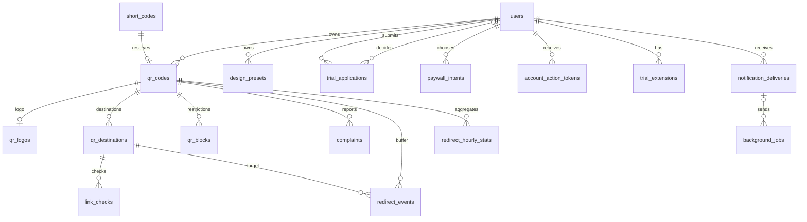

# Модель данных MVP

Основа PostgreSQL для беты кабинета: аккаунты, заявки на пробный доступ, динамические QR,
библиотека пресетов, буфер событий и часовые агрегаты, модерация, уведомления, фейковый paywall
и фоновые задания. Продуктовые правила находятся в [продукте](product.md), границы компонентов —
в [архитектуре](architecture.md).

До запуска существующие миграции изменяются на месте; новые миграции-патчи не создаются.

Миграции создают структуру и ограничения. Обработчики сценариев, worker, отправка почты,
провайдеры проверки ссылок и запросы аналитики реализуются следующими шагами. Созданная таблица
не означает готовность соответствующей функции.

## Сущности и связи

| Таблица                   | Назначение                                                                                    |
| ------------------------- | --------------------------------------------------------------------------------------------- |
| `users`                   | Аккаунт: роль, часовой пояс, email, последний вход, пробный доступ, блокировка, удаление      |
| `sessions`                | Серверные сессии в формате AdonisJS                                                           |
| `account_action_tokens`   | Хеши одноразовых токенов подтверждения email и восстановления доступа                         |
| `trial_extensions`        | Кто, когда, по какой причине и до какой даты продлил пробный доступ                           |
| `trial_applications`      | Заявки на пробный доступ: текст, статус, решение и решивший администратор                     |
| `paywall_intents`         | Выбор варианта фейкового paywall с ценой и валютой на момент показа                           |
| `design_presets`          | Независимые именованные снимки оформления без логотипа                                        |
| `short_codes`             | Постоянный реестр выданных коротких адресов без содержимого и владельца                       |
| `qr_codes`                | Динамический QR, оформление, ручная пауза и корзина                                           |
| `qr_logos`                | Личный файл логотипа динамического QR                                                         |
| `qr_destinations`         | Кандидаты назначения, решения об активации и история смен                                     |
| `link_checks`             | Отдельные попытки проверки конкретного назначения                                             |
| `qr_blocks`               | Независимые причины блокировки QR и история их снятия                                         |
| `complaints`              | Жалобы, обращения о пересмотре и результат рассмотрения                                       |
| `audit_logs`              | Административное действие, автор, причина и идентификатор цели                                |
| `redirect_events`         | Буфер исходных событий переходов на 7 дней                                                    |
| `redirect_hourly_stats`   | Часовые агрегаты переходов по измерениям, источник отчётов                                    |
| `notification_deliveries` | Намерение отправить уведомление и результат доставки                                          |
| `background_jobs`         | Транзакционная постановка работы, расписание, попытки и аренда worker                         |

Полный состав полей, значений и ограничений хранится в
[миграциях](../apps/backend/database/migrations/). `database/schema.ts` генерируется Lucid
после применения миграций и не редактируется вручную.

Модели в `app/models` создаются через `node ace make:model <Name>` и наследуют сгенерированные
schema-классы. Связи объявляются декораторами `belongsTo`, `hasMany`, `hasOne` и типами из
`@adonisjs/lucid/types/relations`. Необязательные связи имеют тип `BelongsTo<...> | null` или
`HasOne<...> | null`. Настройки нестандартных колонок находятся в `database/schema_rules.ts`.
Строковые enum экспортируются из моделей и уточняют поля через `declare`.

В миграциях простые ограничения задаются методами колонок (`checkIn`, `checkPositive`,
`checkRegex`, `checkBetween`), правила между полями — `table.check`. Индексы, включая частичные,
объявляются через `table.index` и `table.unique` с `predicate`; выражения и `NULLS NOT DISTINCT`
создаются через `this.schema.raw`.

Новые предметные сущности используют UUID; идентификаторы пользователей и потоки событий
(`redirect_events`, `redirect_hourly_stats`, `audit_logs`) — bigint. Даты — `timestamptz`;
границы пользовательских периодов вычисляет приложение по часовому поясу.

## Владение и аккаунт

Для ресурсов с владельцем составные внешние ключи `(user_id, id)` проверяют принадлежность QR,
логотипа, назначения, события, агрегата и уведомления одному аккаунту. Это дополнение к проверкам
авторизации в API: знание UUID не даёт доступа.

Роль по умолчанию пользовательская; право назначать администратора проверяет приложение.
Уникальность email учитывает регистр и пробелы по краям.

Токен действия хранится только как хеш, привязан к email на момент выдачи и имеет срок и отметку
использования или отзыва. Для отправки секретная ссылка помещается в зашифрованный payload
уведомления.

Сессии сохраняют формат AdonisJS: `user_id` — строковая метка, а не внешний ключ. При запросе
удаления и блокировке обработчик отзывает помеченные сессии.

Неактивность считается от `coalesce(last_login_at, created_at)`; индекс `users_inactivity_index`
выбирает кандидатов на удаление. Обновление `last_login_at` при входе — обязанность обработчика входа.

Пробный доступ хранится у пользователя (`trial_started_at`, `trial_ends_at`); история продлений —
в `trial_extensions`. Льготный срок отдельной колонки не имеет: приложение вычисляет его как
`trial_ends_at` плюс 14 дней. Ограничения сроков и количества проверяются в обработчиках в
транзакции с блокировкой строки пользователя.

### Заявки на пробный доступ

Одна действующая заявка на пользователя: частичный уникальный индекс `trial_applications_one_active`
покрывает статусы `pending`, `waitlisted` и `approved`. Отклонённые заявки остаются историей,
после них можно подать новую.

`status = 'pending'` тогда и только тогда, когда `decided_at IS NULL`; решение фиксируют
`decided_at` и `decided_by_user_id` (при удалении администратора поле обнуляется). Очередь
выбирается по индексу `(status, created_at)`. Лимит беты и переход из очереди — в приложении.

### Paywall

`paywall_intents` фиксирует выбор варианта (`subscription` или `one_time`) с ценой в минимальных
единицах и трёхбуквенной валютой на момент показа. Запись не выдаёт права и не означает оплату.

## Адреса и ограничения QR

Сначала в транзакции резервируются короткий код и UUID будущего QR, затем создаётся QR. Составной
ключ связывает код с этим UUID. Триггер запрещает обновление и удаление реестра. После окончательного
удаления QR остаются только код, его UUID и дата резервирования.

У модели `ShortCode` первичный ключ — `code`. Технический `short_codes.qr_code_id` не объявляется
внешним ключом или `belongsTo`, поскольку значение сохраняется после удаления QR.

Назначение создаётся кандидатом. Частичные уникальные индексы разрешают одного ожидающего кандидата
и одно активное назначение на QR. Активация одобренного назначения закрывает прежнее в той же
транзакции.

Ручная пауза и корзина хранятся в `qr_codes` (`paused_at`, `deleted_at`); причины блокировки —
в `qr_blocks`. Окно восстановления удалённого QR вычисляется приложением из права аккаунта, поэтому
отдельной колонки срока очистки нет. Снятие блокировки проверки угроз не снимает административную
блокировку и не возобновляет QR.

## Дизайны и файлы

`design_presets` и `qr_codes` содержат самостоятельные JSONB-снимки оформления с версией формата.
Пресет не хранит логотип: параметры размещения логотипа (размер, отступ, подложка) лежат в JSON,
файл пользователь добавляет заново. Назначение, payload статического QR и аналитика в снимок
не входят.

Логотип динамического QR — личный файл в `qr_logos`. Первичный ключ — `qr_code_id`, составной
внешний ключ `(user_id, qr_code_id)` связывает его с владельцем QR. Логотип удаляется каскадно
вместе с QR, в том числе при окончательной очистке; пока QR в корзине, файл сохраняется. Таблица
хранит ключ файла, тип (`image/png`, `image/jpeg`, `image/webp`), размер, размеры изображения и
SHA-256. Колонка `sha256` переименовывается правилом `schema_rules.ts`. Сам файл удаляет
приложение с диска после транзакции, SQL cascade физический файл не удаляет.

## Аналитика

При успешном редиректе приложение записывает в `redirect_events` время, QR, назначение и разобранные
признаки: страну, город, тип устройства, ОС, флаг бота. IP и полный User-Agent не сохраняются.
Сбой записи события не ломает редирект.

`redirect_events` — буфер на 7 дней. Worker сворачивает несвёрнутые события (`aggregated_at IS NULL`)
в `redirect_hourly_stats` и проставляет `aggregated_at`; очистка удаляет события старше 7 дней.
Индексы покрывают выборку несвёрнутых и очистку по времени. Отчёты строятся по агрегатам:
исправление истории старше 7 дней возможно только по агрегатам.

`redirect_hourly_stats` хранит строку на час UTC (`bucket_start`) и комбинацию измерений: страна,
город, тип устройства и ОС. Боты в агрегаты не попадают. Уникальность измерений задаёт индекс
`hourly_stats_dimensions_unique` с `NULLS NOT DISTINCT`: `NULL` — отдельная категория «неизвестно»,
а не пропуск, поэтому строки с одинаковыми измерениями, включая `NULL`, сливаются через
`ON CONFLICT ... DO UPDATE`. Ограничение `bucket_start` выровнено на час в UTC.

Известное ограничение: часовые агрегаты в UTC. Для часовых поясов со смещением, не кратным часу,
границы суток в отчётах приблизительны.

Уникальных посетителей по измерениям без cookie MVP не считает; `visitor_key` в схеме нет.
Дневные уникальные не складываются для периода.

## Удаление данных

Окончательное удаление QR каскадно удаляет назначения, проверки, жалобы, блокировки, буфер
и агрегаты, логотип, а также связанные уведомления и задания. Реестр адреса сохраняется, адрес
не выдаётся повторно. Аудит содержит идентификатор цели и может пережить её удаление, поэтому
в `metadata` нельзя копировать email, URL, секреты или содержимое QR.

Окончательная очистка аккаунта выполняется транзакционно: сохранить ключи файлов для очистки
диска, удалить помеченные сессии, QR со всеми зависимостями, пресеты, затем пользователя.
Один `DELETE users` при зависимых QR может быть отклонён защитными внешними ключами.

## Фоновые задания и уведомления

Задание записывается в PostgreSQL в той же транзакции, что и изменение данных. В payload —
идентификаторы и ожидаемые версии, без паролей и секретных ссылок. Дедупликация активных заданий
и аренда worker проверяются ограничениями; повторы ограничивает ключ дедупликации.

Схема поддерживает доставку как минимум один раз. Обработчики обязаны быть идемпотентными и перед
действием заново проверять актуальное состояние. Секретное содержимое уведомления хранится
зашифрованным, в заданиях остаётся ссылка на уведомление.

## Проверка и следующие этапы

Миграции проверяются на чистой PostgreSQL: создание, откат, повторное применение, составные
внешние ключи, уникальность активной заявки и назначения, постоянство короткого кода, сохранение
логотипа при корзине, `NULL`-измерения агрегатов и очистка зависимостей. Данные рабочего
окружения не используются.

Открыты сроки технического хранения аудита и результатов доставки, провайдеры, формат дизайн-снимка
и рабочие запросы агрегации. Эти вопросы не заменяются неявными значениями по умолчанию в миграциях.
